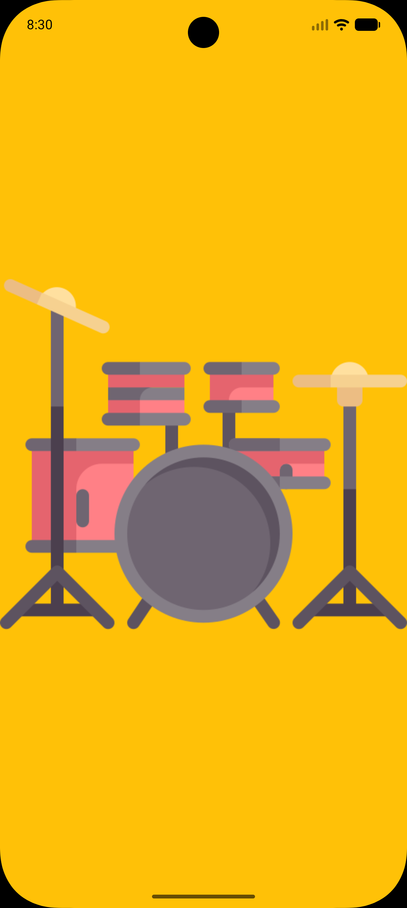

[English](README.md) | [فارسی](README.fa.md)

# Drum Music

[](https://flutter.dev/)
[](https://dart.dev/)
[](LICENSE)

A small Flutter drum app: tap the screen to play bundled percussion samples and build a rhythm. It has one screen, six tap zones, and a drum-kit illustration on an amber background.

## Screenshots

| Drum screen |
| :---: |
|  |

The current screenshot is in `assets/screenshots/`. Add more captures there and extend the table when the app gets new screens; screenshots do not need to be added to `pubspec.yaml` for the README.

## Key features

- Six tap zones in a two-column, three-row grid, each mapped to a different WAV sample.
- A separate audio player for each tap, allowing sounds to overlap instead of replacing the previous hit.
- Bundled sounds and artwork, with no account, backend, or network request needed to play.
- A drum illustration kept at its original aspect ratio with `BoxFit.contain`, with tap zones laid out inside `SafeArea`.
- Audio-player cleanup when playback completes and when the drum page is disposed.

The tap zones cover the screen grid, not the exact outlines of the illustrated drums. The top row plays `h1.wav` and `h2.wav`, the middle row plays `c1.wav` and `c2.wav`, and the bottom row plays `k1.wav` and `k2.wav`.

There is no recording, metronome, sequencer, volume control, or saved-pattern feature in the current version.

## Tech stack and architecture

### Packages

The direct dependencies in `pubspec.yaml` are:

- **Flutter SDK:** Material widgets and the application framework.
- **`audioplayers: ^6.8.1`:** playback of local sound assets through `AudioPlayer` and `AssetSource`.
- **`cupertino_icons: ^1.0.8`:** included as a dependency, but not used by the current screen.
- **`flutter_test` (SDK, development):** Flutter's testing tools.
- **`flutter_lints: ^6.0.0` (development):** the lint rules enabled by `analysis_options.yaml`.

There is no dedicated State Management, networking, database, or local-storage package used by the app. Packages such as `http` and `path_provider` appear transitively in `pubspec.lock`; the application does not use them directly. There is no `build_runner` dependency or code-generation step.

### Structure

```text
drum_music/
├── lib/
│   └── main.dart          # Entry point, app widget, drum screen, audio lifecycle
├── assets/
│   ├── images/
│   │   └── drum.png       # Drum-kit illustration
│   ├── sounds/
│   │   ├── h1.wav
│   │   ├── h2.wav
│   │   ├── c1.wav
│   │   ├── c2.wav
│   │   ├── k1.wav
│   │   └── k2.wav
│   └── screenshots/
│       └── drum-music.png # README screenshot
├── android/              # Android host project
├── web/                  # Flutter web host files
├── analysis_options.yaml
├── pubspec.yaml
├── pubspec.lock
├── .gitattributes
├── README.md
├── README.fa.md
└── LICENSE
```

This is a single-file, widget-based app rather than a Clean Architecture, MVVM, or feature-first project. `main()` starts `Application`, which builds a `MaterialApp` with `DrumPage` as its home screen.

`DrumPage` is a `StatefulWidget`. Its `_DrumPageState` owns a list of active `AudioPlayer` instances and handles playback and disposal. State stays local to the widget; there is no BLoC, Provider, Riverpod, or `setState`-driven UI update. The interface is built with `Stack`, `Positioned.fill`, `Column`, `Row`, `Expanded`, and transparent `GestureDetector` regions.

The package name is `drum_music`, and the version is `1.0.0+1`. The manifest still has the starter description, `"A new Flutter project."`, and `publish_to: 'none'`; this repository is an application, not a package published to pub.dev.

## Getting started

### 1. Install the prerequisites

Install [Flutter](https://docs.flutter.dev/install) and Git. The Dart constraint in `pubspec.yaml` is `^3.12.0` (`>=3.12.0 <4.0.0`). The checked-in lockfile also requires Flutter `>=3.44.0`, so use a Flutter SDK that meets both requirements.

For Android, install Android Studio and the Android SDK, and prepare an emulator or physical device. The Android project targets Java 17; check the Java and Android toolchain with Flutter Doctor. For web, use a browser supported by your Flutter installation.

```bash
flutter --version
flutter doctor
```

Only Android and web host projects are currently checked in. iOS, Linux, macOS, and Windows host projects are not included.

### 2. Clone the repository

```bash
git clone https://github.com/mehrshadkhv/Drum_Music.git drum_music
cd drum_music
```

**Asset path casing:** Git currently records the sound and image folders as `Assets/Sounds/` and `Assets/Images/`, while `pubspec.yaml` and `lib/main.dart` use lowercase paths. Windows can hide this mismatch, but a case-sensitive checkout needs lowercase names. If your checkout still has the uppercase tracked paths, normalize them before running the app:

```bash
mkdir -p assets
git mv Assets/Images assets-images-case-tmp
git mv assets-images-case-tmp assets/images
git mv Assets/Sounds assets-sounds-case-tmp
git mv assets-sounds-case-tmp assets/sounds
```

The temporary names make case-only renames work on Windows as well. These commands stage the asset renames; skip them if the tracked paths have already been corrected. The structure above shows the lowercase paths expected by the app.

### 3. Install dependencies

```bash
flutter pub get
```

No API keys, environment files, backend services, or code-generation commands are required. The runtime asset directories are already declared in `pubspec.yaml`.

### 4. Run the app

Start an Android emulator or connect a device, then run:

```bash
flutter devices
flutter run
```

To run the web version in Chrome instead:

```bash
flutter run -d chrome
```

Tap the left or right half of each screen row to try the six samples. The visible drum illustration is a background image; the touch areas follow the grid described above.

### 5. Check the code

```bash
flutter analyze
```

`flutter_test` is available for adding tests. There are no test files in the current working tree, so a passing test suite is not claimed here.

## GitHub language statistics

`.gitattributes` marks Flutter platform host folders as `linguist-vendored` and generated Dart files (`*.g.dart`, `*.freezed.dart`) as `linguist-generated`. This keeps host boilerplate and generated code out of GitHub's language calculation, so the hand-written Dart code represents the app. The rules do not remove files or affect the build; GitHub applies them after the changes are committed and pushed.

## License

Released under the [MIT License](LICENSE). Copyright © 2026 Mehrshad Khodavirdizadeh.
